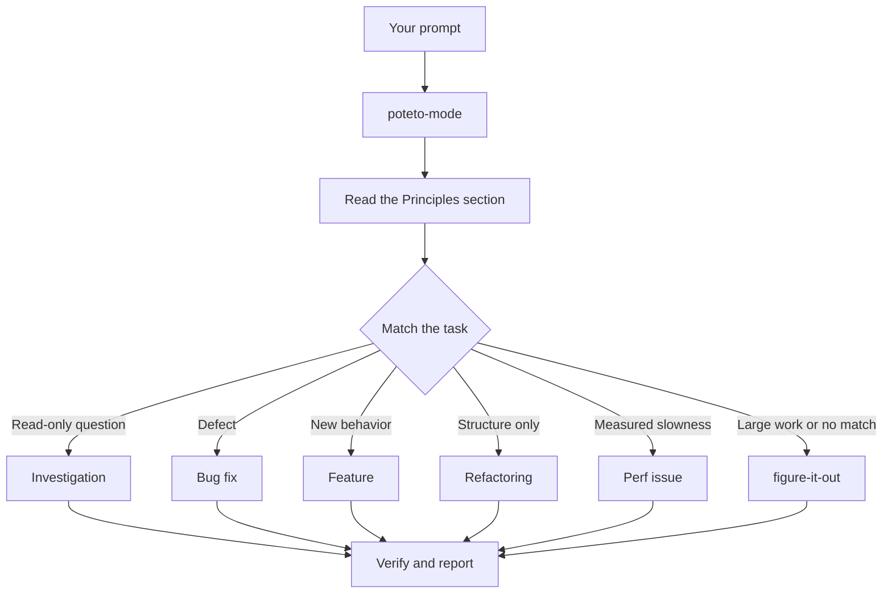

# 作業を `/poteto-mode` に任せる

`/poteto-mode` は作業の入口です。目標を渡すと、23 個のプレイブックから 1 つを選び、その手順を todo リストにコピーし、各ステップで必要になったほかのスキルを呼び出します。このページでは、良いプロンプトとはどういうものか、そして実際に必要な記述がどれほど少ないかを説明します。


## プロンプトはどう処理されるのか



この図は、よく使われる振り分け先を示しています。ほかにも、指標の山登り（hillclimb）、実行時の症状やキャプチャしたトレースの診断、プロトタイプ、見た目の一致（visual parity）、スキルの作成と評価、自律実行、PR やスタックをマージ可能な状態まで見守る作業、検証済みスタックの出荷、PR キューの自動運転、プロジェクト規模のプログラムの統括、セッションの引き継ぎ、安全な一時停止、複数フェーズの計画、worktree の整理のためのプレイブックがあります。全体は[プレイブックのディレクトリ](https://github.com/cursor/plugins/tree/main/pstack/skills/poteto-mode/playbooks/)で確認できます。

## 形式ではなく目標を伝える

仕様書を書く必要はありません。何が問題なのか、何をしたいのかを伝え、エージェントの手間を省ける既知の情報があれば添えます。

```text
/poteto-mode users get two notifications after a retry. repro first, then fix and verify.
```

これは Bug fix のプロンプトです。「repro first」は礼儀ではなく実際の制約であり、プレイブックはそれに従います。todo リストに Bug fix の手順が並んでいく様子を見てください。省略されたステップも `skip: <reason>` として表示されたまま残ります。

<a id="what-goes-in-a-prompt"></a>
## プロンプトに何を書くか

役に立つプロンプトに含まれる要素は最大で 5 つあり、どれも 1 文で書けます。

- **目標**：何が問題なのか、または何をしたいのかを書きます。
- **完了の確認**：成功か失敗かを判定できる必要があります。「良くして」や「1 時間取り組んで」は確認になりません。
- **見たい証拠**：実際のコマンド出力、操作の動画、保存された値、変更前後の数値などを求めます。
- **すでに分かっていること**：症状、再現手順、ログの 1 行、リンクがあれば、エージェントは探す手間を省けます。
- **実際の制約**：「repro first」「don't change any code yet」「zero behavior change」「let me review before proceeding」は、いずれもエージェントの行動を変えます。

5 つすべてを含むプロンプトの例を示します。

```text
/poteto-mode the csv export drops its last row since yesterday's deploy. failing job id is 4812. repro first, then fix. done means the 60k-row fixture exports every row. show me the row counts before and after.
```

一方で、書かないほうがよいものが 2 つあります。

- **やり方**：達成したいことだけを伝え、開発者が選ぶよりも良い道筋をエージェントが見つける余地を残します。スキルの列挙も同様であり、後述の落とし穴で説明します。
- **原因についての自分の仮説（最初の段階では）**：推測を伝えると、探索の範囲が指し示した場所に狭まります。自分の見立てを伝えるのは、エージェントが問題を言い直した後にします。

長いスレッドや曖昧なバグ報告のように情報が雑多な場合は、言い直しを最初のステップにします。

```text
/poteto-mode read this thread. restate the underlying issue in your own words, in plain english. don't change any code yet.
```

誤読があれば、コードが書かれる前に言い直しの段階で現れます。そこで訂正すれば、誤った修正 1 回分ではなく、メッセージ 1 通分の手間で済みます。

## 追加の指示は短くてよい

会話にすでにコンテキストがあれば、プロンプトはほとんど何も書かなくて済みます。次のどれでも十分です。

```text
/poteto-mode do it
```

```text
continue
```

```text
keep going until done
```

短くて済むのは、プレイブックが構造を保持し、Custom Mode によって `/poteto-mode` が毎ターンのコンテキストに含まれるからです。Custom Mode の始め方は [pstack をセットアップする](./01-setup-ja.md#run-your-first-task)で説明しています。開発者の言葉が意図を伝え、スキルが厳密さを担います。

## 「new task」でタスクを切り替える

長いチャットには、直前のタスクのコンテキストが蓄積されます。話題を変えるときは、そのことを明示します。

```text
/poteto-mode new task. figure out why the cache entry survives logout. don't change any code yet.
```

「new task」は、直前のプレイブックを続けるのではなく、振り分けをやり直すよう `/poteto-mode` に指示します。「don't change any code yet」は、このタスクを Investigation に固定します。この 2 つの言い回しがないと、Feature の途中にあるモードは、質問を次の機能開発のステップとして扱いがちです。

## 並行作業には専用のマシンを与える

1 台のコンピューター上で 1 つのリポジトリに対して複数のエージェントを動かすと、作業ツリー、ポート、ビルド出力を奪い合うことになります。最もきれいに分離できるのは [cloud subagent](https://cursor.com/docs/subagents#cloud-subagents) です。それぞれが専用の VM とブランチを持つので、開発者のマシンに触れずに依存関係をインストールし、アプリを動かし、結果を動画に記録できます。タスクの前に `/in-cloud` と入力するか、親チャットに cloud subagent へ作業を渡すよう依頼してください。

作業をローカルで行う必要がある場合は、最初に worktree を指定します。

```text
/poteto-mode new task. branch off <base> in a fresh worktree, then port the parser change there.
```

タスクごとにブランチと worktree を分ければ、エージェントが互いのファイルを壊すことはありません。worktree はディスクとマシンのリソースを消費するので、ノート PC で同時に動かせるのは数個に限られます。[Opening a PR プレイブック](https://github.com/cursor/plugins/blob/main/pstack/skills/poteto-mode/playbooks/opening-a-pr.md)はコード変更の際にもともと worktree を使うので、この指定が必要になるのは、たいてい特定のベースや場所が重要な場合です。

worktree は溜まっていきます。ディスクが逼迫してきたら、次のように依頼します。

```text
/poteto-mode what's eating my disk? prune the worktrees that are safe to prune.
```

[Worktree cleanup プレイブック](https://github.com/cursor/plugins/blob/main/pstack/skills/poteto-mode/playbooks/worktree-cleanup.md)は、すべての worktree をマージ状態、未コミットの作業、まだその worktree に触れているチャットによって分類します。削除するのはその証拠で安全と確認できたものだけであり、未コミットの作業を含む worktree については、一時停止して開発者の判断を待ちます。

## 動かしたまま離れる

席を外すときは、完了が何を意味するのかを伝えてから離れます。

```text
/poteto-mode im stepping away. keep going until the migration check reports zero old callers. log your decisions.
```

後でレビューする作業は [`/figure-it-out`](https://github.com/cursor/plugins/blob/main/pstack/skills/figure-it-out/SKILL.md) に振り分けられます。このスキルは実行のフェーズを設計し、[`/show-me-your-work`](https://github.com/cursor/plugins/blob/main/pstack/skills/show-me-your-work/SKILL.md) の判断ログを残します。夜間作業の契約の全体は[寝ているあいだに作業を進める](./07-overnight-ja.md)で説明しています。

**落とし穴：** プロンプトでスキルを列挙しないでください（「use /how, then /architect, then /arena...」など）。プレイブックはすでにスキルの順序を決めており、手書きの順序はたいてい、プレイブックなら残したはずのステップを入れ替えたり落としたりします。スキルの名前を挙げるのは、特定の選択を上書きしたいときだけにします。

振り分けの規則の全体は、[`poteto-mode`](https://github.com/cursor/plugins/blob/main/pstack/skills/poteto-mode/SKILL.md) 自体を読んでください。

次へ: [コードを理解する](./03-understand-ja.md)
