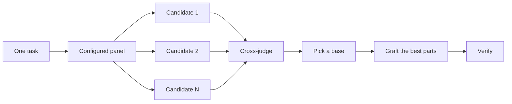

# コードを書く前に設計する

難しい設計を 1 回だけ試すと、モデルが最初に思いついた形で固まってしまいます。`/architect` は、実装の前に型と境界を決めます。`/arena` は、同じ依頼に対して複数の試案を作らせ、最も良い部分を統合します。`/interrogate` は、ほかのモデルに結果を壊しにかからせます。設計の統合ではなく網羅が目的であれば、`/swarm` が作業を区画やレースに分けて並行させ、その結果を集約します。

設計で最もよくある誤りは 2 つあります。エージェントが出した最初の設計をそのまま採用すること、そしてコードで一度も試していない計画を磨き続けることです。このページではその両方に対処します。計画はコードを通じて立てます。プロトタイプで未解決の問いに答え、README やチュートリアルで目標を定め、文書としての計画は最後に書きます。


## `/architect` で形を決める

```text
/architect design the import pipeline before writing any code. i care most about how callers use it.
```

[`/architect`](https://github.com/cursor/plugins/blob/main/pstack/skills/architect/SKILL.md) は、まず足場を固めます。設計が関わるコードに対して `/how` を実行し、所有権やレイヤーを動かす場合は `/why` も実行します。次に `/arena` を実行して競合する設計案を作らせます。各案では、まず呼び出し側の使い方を書き、続いて型、シグネチャ、モジュール構成図を示します。

既定では、統合した設計からそのまま実装に進みます。先に設計を確認したい場合は、そう伝えます。

```text
/architect with checkpoint. stop and show me before implementing.
```

コードを書き始めた後も、設計は絶対のものではありません。実装の過程で、無関係な箇所に同じ回避策が現れたり、`any` や強制キャストを使わないとコンパイルできない型が出てきたりした場合、`/architect` はそれを設計が誤っている証拠として扱います。その場しのぎで取り繕うのではなく、設計案を破棄してやり直します。

## `/arena` で複数の試案を作る

```text
/arena take my prompt to the arena verbatim. i want to compare their proposals with yours.
```

[`/arena`](https://github.com/cursor/plugins/blob/main/pstack/skills/arena/SKILL.md) は、その土台となる汎用の道具です。N 個のサブエージェントが、同じ設計またはコードの依頼に並行して取り組み、それぞれ専用の worktree またはディレクトリに書き出します。読み取り専用の審査役（設定が許せば別系統のモデル）が、ルーブリックに従ってすべての候補を採点します。取りまとめ役はすべての候補を最初から最後まで読み、土台にする案を選び、採用されなかった案から最も良いアイデアを移植し、結果を検証します。



パネルの構成は [`/setup-pstack`](https://github.com/cursor/plugins/blob/main/pstack/skills/setup-pstack/SKILL.md) の設定から決まり、タスクごとに調整できます。重要な判断では候補を増やし、そうでなければ減らします。

```text
/arena this, 5 candidates. the cache key format is expensive to change later.
```

## `/swarm` で区画やレースを網羅する

```text
/swarm check every package under packages/ against its check.sh. one worker per package. one report.
```

[`/swarm`](https://github.com/cursor/plugins/blob/main/pstack/skills/swarm/SKILL.md) は、N 個のワーカーを、互いに独立した区画、網羅表（coverage matrix）、ガントレットのレーン、探索の分割、宣言済みのレースのアームに割り当てます。各ワーカーは専用の範囲と確認方法を受け取り、`PASS`、`ISSUES`、`BLOCKED` のいずれかを報告します。親はワーカーの完了を待ち、抜けや脱落を含めた 1 つの簡潔なレポートを返します。

`/swarm` を使うのは、並行化によって網羅性が高まるときか、独立した確認同士を競わせたいときです。`/arena` はすべてのワーカーに同じ設計またはコードの依頼を渡し、土台を選んで最も良い部分を移植します。`/swarm` は区画を網羅するか、選択の規則を事前に宣言したレースを実行します。土台の選択と移植という手順は使いません。

## `/interrogate` で壊しにかかる

```text
/interrogate the whole branch, but skeptically. no nitpicks unless it's an actual bug or regression.
```

[`/interrogate`](https://github.com/cursor/plugins/blob/main/pstack/skills/interrogate/SKILL.md) は、同じ diff、意図、ルーブリックを、別系統のモデルのレビュアーに送ります。モデルの多様性がこのスキルの要点です。モデルによって見落としの傾向が違うので、2 つのモデルが独立に指摘した問題は信頼度の高い兆候になります。リーダー役はすべての指摘を `Act on`、`Consider`、`Noted`、`Dismissed` に分類し、却下したものには理由を添えますが、何も自動では適用しません。

却下された指摘にも目を通してください。リーダー役は実務的なシニアエンジニアであって、絶対に正しい判定者ではなく、開発者はその判断を覆せます。

## 議論する代わりにプロトタイプを作る

最初の設計を採用しないでください。いくつかの案を求め、目で確認できる証拠から選びます。

```text
/poteto-mode prototype a few options for the new dropdown menu. take screenshots or videos for me to compare.
```

[Prototype プレイブック](https://github.com/cursor/plugins/blob/main/pstack/skills/poteto-mode/playbooks/prototype.md)は、作業用ディレクトリに使い捨ての試作を作り、各案を 1 つの切り替え UI の後ろに置き、それぞれを操作して、スクリーンショットや計測時間を記録します。UI だけでなく、振る舞いやアルゴリズムにも使えます。プロトタイプは、コードを使った計画です。エージェントは開発者に尋ねる代わりに、何かを実行して自分の疑問に答えられます。また、開発者が思いつかなかった選択肢が出てくる余地も残ります。

同じ考え方は本格的な設計にも広げられます。`/architect` とプロトタイプを組み合わせ、レビューの関門を設けます。

```text
/poteto-mode we need rate limiting for external webhooks. /architect it first, and answer open questions with prototypes. let me review before proceeding.
```

抽象的な計画にレビュアーを費やさないでください。`/interrogate` は diff に対して使うものです。裏付けるコードのない計画に敵対的レビューを向けると、レビュアーは決して起こらない理論上のリスクや境界条件を作り出します。プロトタイプで疑問を解消してから、実際に作られたものをレビューします。

## 共有コードでは README を先に書く

ほかのコードから使われるパッケージや API では、利用者が読むドキュメントから書き始めます。

```text
/poteto-mode write a tutorial for how i would use the new config package first. then /teach me why it beats the current one.
```

チュートリアルを先に書くと、呼び出し側の視点を取らざるを得なくなります。仮想の利用者に API を説明し、そこから実装へと逆算していきます。ドキュメントは、エージェントが自分の作業を照合する具体的な目標にもなります。ドキュメント自体が重要な場合は [`/technical-writing`](https://github.com/cursor/plugins/blob/main/pstack/skills/technical-writing/SKILL.md) を指定してください。そうすれば、チュートリアルがリファレンスと解説の混ざったものに変わることなく、チュートリアルのまま保たれます。

## 設計が固まってから計画を立てる

pstack には、あえて計画用のスキルがありません。文書としての計画が必要な場合は、設計が固まってから依頼します。

```text
/poteto-mode turn this design into a plan. small verifiable PRs, each with its own verification steps.
```

[Multi-phase plan プレイブック](https://github.com/cursor/plugins/blob/main/pstack/skills/poteto-mode/playbooks/multi-phase-plan.md)は、残っている疑問をプロトタイプで解消してから、PR ごとに 1 つの節を書きます。各節は、変更が動くことの証明で締めくくります。テストスイートが通るだけでは、その証明とは見なしません。成果物は計画そのものです。このプレイブックは計画を実装せず、次にどの実行用プレイブックで進めるべきかを示します。

移行作業では、プロンプトで基準を明示します。

```text
/poteto-mode plan the migration of our ui library to the new styling system. small verifiable PRs, each with visual regression checks. the result must match the original exactly, bugs included.
```

「bugs included」と書くと、移行の途中で黙って不具合を直すことを防げます。途中で直してしまうと、新旧の出力を比較できなくなるからです。何日にもわたるプロジェクトでは、ほかのエージェントが進行中の作業を把握できるよう、しばらく計画をリポジトリにコミットしておいても構いません。作業がマージされたら削除してください。

## タスクにはどの程度の設計作業が必要か

すべての変更にここまでの作業が必要なのか、疑問に思うかもしれません。答えは「いいえ」であり、ほとんどの変更にはどれも必要ありません。おおまかな段階は次のとおりです。

- 完成していても確信の持てない小さな変更には、`/interrogate` だけを使います。
- 関数の境界をまたぐ変更や、所有権を動かす変更には `/architect` を使い、それに伴って `/arena` も実行されます。
- 命名、フォーマット、アルゴリズムのように、独立した試案が役立つ単独の判断には、`/arena` を直接使います。
- 網羅表、並行した確認の集合、アームを宣言したレースには `/swarm` を使います。
- レイアウト、タイミング、手法のように、何かを実行すれば答えが出る疑問には、議論ではなくプロトタイプを使います。
- 意見が分かれ、後から覆すのにコストがかかる設計には、`/architect` を使い、出荷前に `/interrogate` をかけます。
- 複数の PR にまたがる作業には、設計が固まった後に書いた計画を用意します。

`/poteto-mode` は、すでにこの段階に従って判断します。境界をまたぐ作業では自動的に `/architect` が起動するので、これらのスキルを直接使うのは、主に既定よりも厳しく、または緩く精査したいときです。

次へ: [変更を実装して整える](./05-build-and-clean-ja.md)
