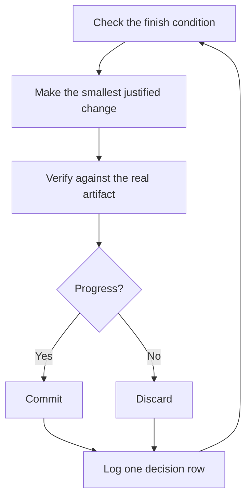

# 寝ているあいだに作業を進める

ここまでの内容は、すべてこのページのためにあります。自分の作業を検証できると信頼できるエージェントなら、難しいタスクを任せて離れられます。それを安全にするのは期待ではありません。確認可能な完了条件、分離された worktree または cloud agent、そして朝に監査する判断ログです。


## ループの前に信頼を確立する

信頼できないループは、未確認の作業をより速く生み出すだけであり、混乱は反復のたびに積み重なります。ループを動かしたまま離れる前に、そのループが信頼に値するかを確認してください。

- そのタスクを一度自分の手で行ったか、エージェントが行うのを見たことがあり、良い結果がどういうものかを知っている
- エージェントが、開発者自身が使う道具と手がかり（検証スキル、プロファイラ、ログ）を持っている
- どの段階も自分の作業を証明し、作業が基準に届かなければラインを止められる
- いくつかのトランスクリプトを読み、繰り返される失敗を道具、スキル、確認に変えてある

ループを自律させるのは、4 つすべてが成り立ってからにします。それまでは、見守りながら動かします。

## 夜間作業の契約

良い引き継ぎには、目標、完了条件、権限、そして脱出口が含まれます。長く書く必要はありません。

```text
/poteto-mode im going to bed. migrate every caller to the new parser in a fresh worktree off <base>.
done means zero old callers, all parser fixtures pass, old api deleted.
keep a decision log. don't ask me before committing.
/loop until done. if you're truly stuck after a few hours, stop and write up why.
```

各行が何をもたらすのかを順に見ていきます。

- 「im going to bed」はセッションの上書き指示です。エージェントは質問するのをやめ、作業を続けます。
- 「done means...」は、目標を、毎回の反復で実行できる確認に変えます。
- 「fresh worktree off `<base>`」は、開発者が開いているほかの作業と実行が衝突しないようにします。
- 「don't ask me before committing」は、本来ならエージェントが止まって尋ねるはずの権限について、先に答えておきます。
- `/loop` は pstack のスキルではなく、Cursor に組み込まれた再開の仕組みです。[Autonomous run プレイブック](https://github.com/cursor/plugins/blob/main/pstack/skills/poteto-mode/playbooks/autonomous-run.md)はこれを使い、イベントや定期的なハートビートのたびに完了条件を確認し直します。
- 脱出口があれば、エージェントは本当の行き詰まりで止まり、その理由を書き残せます。8 時間かけて目標を独創的に解釈し直されるよりも、そのほうがはるかに良い結果です。

この作業は離れた後でレビューするものなので、`/poteto-mode` はこれを [`/figure-it-out`](https://github.com/cursor/plugins/blob/main/pstack/skills/figure-it-out/SKILL.md) に振り分けます。このスキルは、コードを書く前に実行のフェーズを設計し、判断ログを組み込みます。

意図して実行を止めるには、一時停止するよう伝えるか、これからオフラインになる、または Cursor を再起動すると伝えます。[Pause safely プレイブック](https://github.com/cursor/plugins/blob/main/pstack/skills/poteto-mode/playbooks/pause-safely.md)は、現在のステップを完了させるか取り消し、作業途中のチェックポイントをコミットし、再開用のメモを書きます。新しいチャットは、Session pickup プレイブックを通じてそのメモから作業を引き継ぎます。「keep going」と伝えても、一時停止は決して起動しません。

## ループは夜通し何をしているのか



反復のたびに、変更を 1 つ、確認を 1 つ、ログを 1 行残します。効果のなかった変更は放置せずに破棄します。停滞したときは止まるのではなく方針を切り替え、勝利を宣言するために完了条件をこっそり緩めることは決してありません。

## 朝の監査

実行をレビュー可能にするのは [`/show-me-your-work`](https://github.com/cursor/plugins/blob/main/pstack/skills/show-me-your-work/SKILL.md) です。各行には、時刻、フェーズ、判断、理由、証拠の参照先、結果が記録され、`decisions.tsv`（複数の実行が同じディレクトリを共有する場合は `.audit/<task-slug>.tsv`）という TSV に保存されます。既定ではローカルにとどまります。作業が大がかりで、レビュアーが結果を信頼するために記録が必要な場合は、コミットしてください。

戻ってきたら、実行内容をレビュー向けの形で求めます。

```text
/show-me-your-work catch me up on what you did last night
```

スキルは要約を返す前に、別系統のモデルのレビュアーを起動して記録とトランスクリプトを読ませます。返信の最後には Attention 節があり、精査すべき点が列挙されます。まずその節を読み、次にそこで示されたログの行を読みます。開発者が監査するのは判断であり、一晩分の作業をすべて読み直す必要はありません。

## 夜にこなすのがタスクではなくキューの場合

先ほどの契約は、1 つのタスクを 1 つの完了条件まで進めるものです。夜によっては、独立した変更のキューや、プログラム全体のように、もっと多くの作業を抱えることもあります。3 つのプレイブックが、同じ信頼の仕組みを大きな規模に広げます。

[Autopilot-full](https://github.com/cursor/plugins/blob/main/pstack/skills/poteto-mode/playbooks/autopilot-full.md) は、独立した PR のキューをマージまで進めます。各 PR には担当のエージェントが 1 つ付き、実装からマージまでを受け持ちますが、どの担当も自分の判定だけでマージすることはありません。新しい検証役の swarm が、担当のコードが準備できた時点の head で 1 回目の確認を始め、その後パッチを変えるプッシュがあるたびに確認をやり直します。マージを許可するのは、実際にマージされるパッチに対するクリーンな判定だけです。

```text
/poteto-mode full autopilot on this queue. each item is independent. i want them merged by morning.
```

[Autopilot-stack](https://github.com/cursor/plugins/blob/main/pstack/skills/poteto-mode/playbooks/autopilot-stack.md) は、同じ担当のループを回しますが、何も出荷しません。朝には、ベースブランチの上に 1 本の直線的なスタックができており、各要素には検証役の判定が付いています。それをレビューしてマージするのは開発者自身です。変更同士が結びついている場合や、マージ前に自分の目で作業を確認したい場合は、Autopilot-full ではなくこちらを選びます。

```text
/poteto-mode autopilot these five changes but stack them, don't ship. i'll land the stack in the morning.
```

[Orchestrate](https://github.com/cursor/plugins/blob/main/pstack/skills/poteto-mode/playbooks/orchestrate.md) は、1 つのエージェントの寿命を超えるプログラム向けです。たとえば、数日にわたり、多数の PR を積み重ね、1 つの常駐する取りまとめ役のチャットのもとで大量のサブエージェントを動かすような作業です。取りまとめ役は指示書を作成し、サブエージェントが完了したものを回収し、マージされていない最も下の PR のチェックを通った状態に保ち、自分ではコードを書きません。意図的に重い仕組みにしてあります。1 つのエージェントが 1 セッションで作業を終えられるなら、プレイブック自体が先ほどの夜間作業の契約へ振り分け直します。

```text
/poteto-mode orchestrate the store migration. own it until every package is converted and merged. i'll check in twice a day.
```

<a id="run-many-projects-in-parallel"></a>
## 多数のプロジェクトを並行して動かす

[Cursor Project](https://cursor.com/blog/projects) を使うと、1 つの取りまとめ役のエージェントに永続的なスレッドを持たせられます。取りまとめ役はコードを書きません。サブエージェントに指示を出し、サブエージェントは既定でクラウドで動くので、ノート PC を閉じていても作業は続きます。これが Orchestrate プレイブックの想定する形です。取りまとめ役へのプロンプトを `/poteto-mode` で始めれば、取りまとめ役が起動したサブエージェントはプレイブックに従います。

次の習慣が役に立ちます。

- 機能開発、移行、性能改善、技術的負債の整理のように、まとまった作業ごとに専用の Project を用意します。複数の Project を並べて動かせます。
- 関連するチャットは、完了したものも含めて Project にドラッグします。それらは Project 内のすべてのエージェントのコンテキストになります。
- 各 PR には、マージ前に検証用の swarm を割り当て、キューの処理は Autopilot-stack か Autopilot-full に任せます。
- 取りまとめ役には、データに裏付けられた計画を求め、開発者に尋ねる前にプロトタイプで疑問に答えさせます。

1 つのプロンプトで、調査から実行までの Project 全体をまかなうこともできます。

```text
/poteto-mode refactor this repo so its architecture is more agent friendly. use /correct and /architect on past commits and review comments to find the mistakes agents make most here. use /recall for context from past chats. answer open questions with prototypes instead of asking me. come back with a plan backed by real data. once i approve it, run it with autopilot-stack or autopilot-full, and ask me which.
```

## ループが自分で始まるようにする

ここまでのループは、どれも開発者が開始するのを待っています。スケジュールやイベントで起動するオートメーションを使えば、その手間がなくなります。ソフトウェアの保守は、この仕組みに向いた段階に分けられます。報告の選別、再現、修正、修正の検証です。こうしたラインを信頼できる状態に保つ規則は 2 つあります。

- どの段階もラインを止められること。選別の段階では報告が想定どおりの振る舞いだと判断でき、再現の段階では再現できないことがあり、修正役は変更のリスクが高すぎると判断できます。これらの結果はどれも役に立ちます。質の悪い作業が、取り消すのによりコストのかかる次の段階に進むのを防げるからです。
- どの段階も証拠を引き渡すこと。再現の段階では壊れた状態のスクリーンショットと動画を添え、修正の段階では変更前後の証拠を添えます。そうすれば人間は、コードを 1 行も読む前に、エージェントが正しいものを直したかを確認できます。

pstack は、Slack の課題報告向けに、これを休止状態の[オートメーションパック](https://github.com/cursor/plugins/blob/main/pstack/automations/benny/README.md)として同梱しています。一方のオートメーションは各報告を選別します。もう一方は確認済みのバグを再現し、小さな修正のドラフトを用意することもあります。セットアップするには、エージェントにその [`FOR_AGENTS.md`](https://github.com/cursor/plugins/blob/main/pstack/automations/benny/FOR_AGENTS.md) を読ませ、対象のリポジトリを指定します。

**落とし穴：** 時間の長さは完了条件ではありません。「work on this for 4 hours」では、エージェントには確認するものが何もなく、朝には結果ではなく 4 時間分の動きだけが残ります。`/loop` には、成功か失敗かを判定できる条件を渡してください。

次へ: [原則の名前で舵を取る](./08-principles-ja.md)
